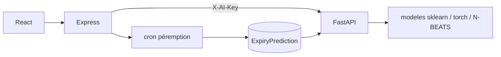

# Service IA Stokify

Micro-service FastAPI appelé par l'API Node. Il ne parle pas directement au navigateur.



Le journal `ExpiryPrediction` enregistre un instantané par lot au moment du score. Après la DLC, un cron étiquette le résultat réel. Un réentraînement dominical ne remplace le modèle de production que si la perte de validation n'est pas pire de plus de 2 %.

## Sécurité

- En-tête `X-AI-Key` comparé avec `hmac.compare_digest`. Une clé vide est acceptée seulement hors production. `AI_ENV=production` refuse le démarrage si la clé fait moins de 32 caractères.
- `/health` et `/ready` sont publics. Les autres routes exigent la clé.
- Les calculs lourds passent par un sémaphore (`AI_MAX_HEAVY`, défaut 2). Au-delà : HTTP 429.
- Côté Node, `aiLimiter` (30/min) et `chatLimiter` (12/min, 200/jour) protègent les routes IA.

## Commandes

```bash
uvicorn main:app --host 0.0.0.0 --port 8000
python -m expiry.train
python -m pytest -q
python eval/forecast_report.py
python eval/anomaly_report.py
```

L'export des ventes mensuelles se lance depuis `back` : `npm run eval:ai`.

## Variables

| Variable | Rôle |
| --- | --- |
| `AI_SERVICE_KEY` | Clé partagée avec Node |
| `AI_ENV` | `production` impose une clé longue |
| `AI_MAX_HEAVY` | Nombre de calculs lourds simultanés |
| `AI_NBEATS_CACHE` | Taille du cache LRU N-BEATS |
| `EXPIRY_MODELS_DIR` | Dossier des artefacts de péremption |
| `EXPIRY_AUTOTRAIN` | `0` désactive l'entraînement de secours au démarrage |
